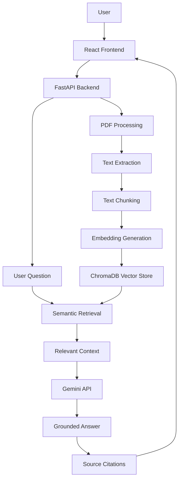

# TraceRAG – Advanced RAG Research Assistant

An Advanced Retrieval-Augmented Generation (RAG) Research Assistant for intelligent PDF question answering, semantic retrieval, and multi-document comparison with source citations.

## Overview

TraceRAG is an AI-powered research assistant that allows users to upload research papers and PDF documents, ask questions using natural language, and receive context-aware answers grounded in the uploaded documents.

It combines semantic search, vector embeddings, ChromaDB, and Google's Gemini API to retrieve relevant document passages and generate answers with source references.

## Key Features

- **PDF Upload:** Upload and process research papers and PDF documents.
- **Document Processing:** Extract text and divide documents into manageable chunks.
- **Semantic Search:** Retrieve relevant passages using vector embeddings.
- **AI-Powered Question Answering:** Generate context-aware responses using Gemini.
- **Source Citations:** Provide references to supporting document content.
- **Multi-Document Comparison:** Compare information across multiple uploaded documents.
- **Document Management:** View and delete uploaded documents.
- **Retrieval Evaluation:** Evaluate retrieval performance using standard information retrieval metrics.

## Architecture



## Technology Stack

| Component | Technology |
|---|---|
| Frontend | React.js, TypeScript, Vite |
| Styling | CSS |
| Backend | Python, FastAPI |
| PDF Processing | PyMuPDF |
| Embedding Model | Sentence Transformers – all-MiniLM-L6-v2 |
| Vector Database | ChromaDB |
| AI Model | Google Gemini API |
| API Communication | REST API |
| Version Control | Git and GitHub |

## Project Structure

```text
TraceRAG/
│
├── backend/
│   ├── evaluation/
│   │   ├── evaluate.py
│   │   ├── metrics.py
│   │   └── test_dataset.json
│   │
│   ├── src/
│   │   ├── answer.py
│   │   ├── chunker.py
│   │   ├── embedding_store.py
│   │   ├── main.py
│   │   ├── pdf_loader.py
│   │   └── search.py
│   │
│   ├── api.py
│   ├── requirements.txt
│   └── test_retrieval.py
│
├── frontend/
│   ├── public/
│   ├── src/
│   │   ├── assets/
│   │   ├── App.tsx
│   │   ├── App.css
│   │   ├── index.css
│   │   └── main.tsx
│   │
│   ├── package.json
│   └── vite.config.ts
│
├── .gitignore
└── README.md
```

## Installation and Setup

### 1. Clone the Repository

```bash
git clone https://github.com/deepikrish2007-dot/TraceRAG.git
cd TraceRAG
```

### 2. Backend Setup

Create and activate a Python virtual environment:

```bash
python -m venv .venv
```

Windows:

```bash
.venv\Scripts\activate
```

Install dependencies:

```bash
pip install -r backend/requirements.txt
```

### 3. Configure Environment Variables

Create a `.env` file in the project root:

```env
GEMINI_API_KEY=your_gemini_api_key
GEMINI_MODEL=your_supported_gemini_model
```

Replace the placeholder values with your own credentials and configured model.

**Important:** Never upload your actual API key or `.env` file to GitHub.

### 4. Start the Backend

Run from the project root:

```bash
python -m uvicorn backend.api:app --reload
```

Backend API:

`http://127.0.0.1:8000`

Interactive API documentation:

`http://127.0.0.1:8000/docs`

### 5. Frontend Setup

Open another terminal:

```bash
cd frontend
npm install
npm run dev
```

Open the local frontend URL displayed by Vite, usually:

`http://localhost:5173`

## API Endpoints

| Method | Endpoint | Description |
|---|---|---|
| GET | `/` | Backend health check |
| GET | `/documents` | List uploaded documents |
| GET | `/documents/{filename}/view` | View a document |
| POST | `/upload` | Upload a PDF |
| POST | `/ask` | Ask questions about documents |
| DELETE | `/documents/{filename}` | Delete a document |

## Retrieval Evaluation

TraceRAG includes a retrieval evaluation module to measure the effectiveness of semantic retrieval.

The following results were obtained from the project's five test cases:

| Metric | Result |
|---|---:|
| Precision@5 | 0.4400 |
| Recall@5 | 1.0000 |
| MRR | 0.9000 |
| Hit Rate@5 | 1.0000 |
| nDCG@5 | 0.9101 |
| Source Coverage | 1.0000 |

**Evaluation summary:**
- Test cases evaluated: 5
- Successful test cases: 5
- Failed test cases: 0

*Note: These results represent the project's current five-case evaluation dataset and are not a general performance guarantee.*

## Current Limitations

- Answer quality depends on the quality and content of uploaded documents.
- Processing time can increase with large PDF files.
- Retrieval quality depends on document chunking and embedding relevance.
- Gemini API availability and usage limits can affect response generation.

## Future Enhancements

- Support additional document formats.
- Improve retrieval and reranking strategies.
- Add conversational memory.
- Introduce hybrid search using keyword and semantic retrieval.
- Improve response streaming and processing performance.
- Add user authentication and document-level access control.
- Expand the retrieval evaluation dataset.

## Author

**TraceRAG – Advanced RAG Research Assistant**

GitHub: https://github.com/deepikrish2007-dot/TraceRAG

---

*Built to make research paper exploration, document understanding, and knowledge discovery more efficient using Retrieval-Augmented Generation.*
